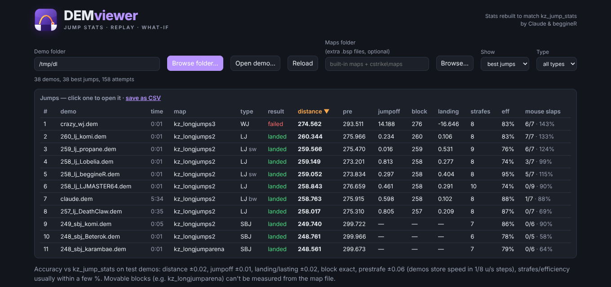
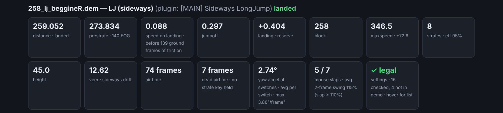
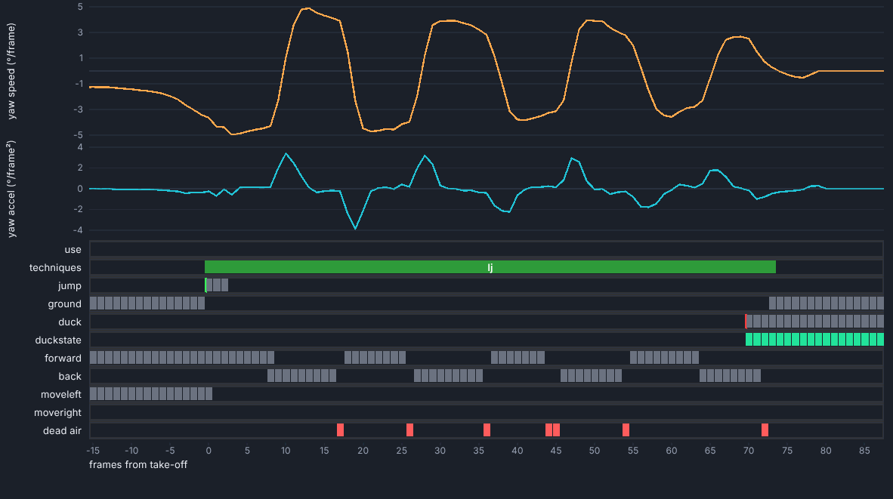
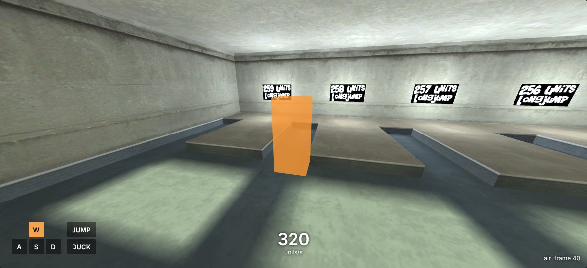
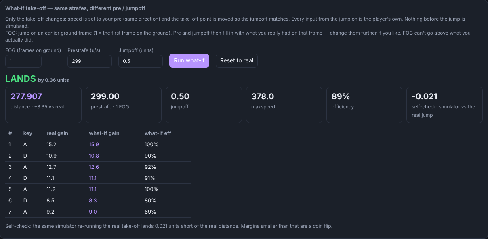

# DEMviewer

Jump stats, 3D replay, strafe and yaw analysis and what-if simulation for **CS 1.6 kreedz demos** (.dem).
By Claude & beggineR.



## Download

Get the latest **DEMviewer.exe** from [Releases](../../releases), then just run it: no install needed.
`kz_longjumps2`, `kz_longjumps3` and `kz_longjumparena` are built in. Other maps are picked up from your
`cstrike/maps` or `cstrike_downloads/maps` folder, or from a maps folder you choose in the app.

Linux: build it yourself (see Build below). It opens in your browser.

## What it does

**Jump list**
- Finds every jump in every demo in a folder: LJ, HJ, CJ, DCJ, MCJ, WJ, BJ, SBJ and ladder jumps, with backwards and sideways detection.
- **Best jumps** shows one valid landed jump per demo; **all attempts** shows every jump with the time it happens in the demo.
- Click any column header to sort; the type filter and the demo's file name (`_lj_`, `_sbj_`, `_ldj_` ...) help find the right jump.

**Stats that match the server plugins**



- Distance, prestrafe, FOG, jumpoff, block, landing / lasting, maxspeed and gain, strafes and efficiency, rebuilt to match
  **kz_jump_stats** (distance within about 0.02 on tested demos) and the [MAIN] ladder stats.
- Strafe table with gain, loss, eff, overlaps, **dead airtime** and GC-style turn efficiency.
- **Mouse slaps**: strafe switches where the mouse hits the other side like a wall (2-frame swing of 110% or more),
  calibrated on known slap and no-slap demos.
- **Yaw acceleration at switches**, average and peak.
- **Settings check**: server movement settings, cl_lw and fps from the demo, compared with the league rules.

**Timeline**



- Yaw speed and yaw acceleration graphs, and one block per frame for every key: jump, duck, forward, back, moveleft, moveright, ground, duck state and dead air.
- Mouse wheel zooms, dragging moves, clicking jumps the replay to that frame, hovering shows the frame (or the jump's stats).

**3D replay in the real map**



- First person, behind, side or top view.
- **Real player and weapon models** from your own game (`cstrike/models`, found automatically or picked under
  *Models folder*): the CT/T model and weapon from the demo, with run, crouch and jump animations and aiming.
  The viewmodel shows as in the demo (hidden after `/hide`), or always / never. The player's hitbox is still
  available to judge edge landings. Models are read from your install, never shipped with DEMviewer.
- **Fullscreen** with play, speed (0.1x to 1x) and time controls on screen.
- Moving blocks (bhop blocks, longjumparena layouts) move like they did in the demo.

**What-if**



- Re-runs the player's real inputs from take-off with a different prestrafe, jumpoff or FOG, using GoldSrc air physics.
- Shows whether it lands, the new distance, a self-check of the simulator against the real jump, and a replay with the real jump as a ghost.
  The simulated run is drawn as the opposite team's model, so it never gets mixed up with the real one.
  Simulated replays are always marked **WHAT-IF · SIMULATED**.

## Releases and versions

Every push to `main` is built for Windows and Linux by GitHub Actions
(`.github/workflows/release.yml`) and published as a new release with
**DEMviewer.exe** and **DEMviewer-linux-amd64**. The version shown in the app
header is the release version.

Versions follow semantic versioning, `vMAJOR.MINOR.PATCH`, bumped from the
commit messages since the last release:

| Commit message starts with | Bump | Example |
|---|---|---|
| `fix:` or anything else | patch | 1.2.3 → 1.2.4 |
| `feat:` | minor | 1.2.3 → 1.3.0 |
| `feat!:` / `fix!:`, or a line `BREAKING CHANGE` | major | 1.2.3 → 2.0.0 |

Release notes are written by hand in [CHANGELOG.md](CHANGELOG.md): add entries under
**Unreleased**, and the release workflow uses that section as the release notes, then
moves it under the new version number.

Put `[skip release]` in a commit message to build without publishing.
Changes to only the README, CHANGELOG or `docs/` don't trigger a build. You can also start
a release by hand under **Actions → Build and release → Run workflow** and pick
the bump. Pull requests are built but not released.

The latest Windows build is always at
`https://github.com/begginer42069-netizen/demoviewer/releases/latest/download/DEMviewer.exe`.

## Build

Needs Go 1.24 or newer. Everything else is in this folder, so no internet is needed.

```
sh build.sh            # version shows as "dev"
VERSION=1.2.3 sh build.sh
```

`build.sh` assembles `web/index.html` from `web/head.html`, `web/app.js` and
`web/renderer.js`, then builds:

- `dist/DEMviewer.exe`: Windows, its own window (WebView2), no console
- `dist/DEMviewer-linux-amd64`: Linux, opens in the browser

Run `build.sh` again after editing anything in `web/`, because the HTML is embedded into the binary.

Building by hand on Windows (PowerShell), after `web/index.html` exists:

```
$env:GOFLAGS="-mod=mod"; $env:GOPROXY="off"
go build -trimpath -ldflags "-s -w -H=windowsgui" -o DEMviewer.exe .
```

## Files

| File | What it does |
|---|---|
| `demo.go` | Reads the GoldSrc .dem format: header, directory, frames (origin, velocity, view, usercmd), text messages |
| `net.go` | Decodes network messages: delta descriptions, baselines and packet entities, used to place moving brush entities (bhop blocks, arena doors) |
| `bsp.go` | Loads maps (built-in `embedmaps/*.bsp.gz` first, then map folders), block edges and floors |
| `stats.go` | Jump detection and kz_jump_stats-style stats: distance, pre, jumpoff, block, landing, strafes, efficiency, GC efficiency, jump type, mouse slaps, replay data |
| `web/studio.js` | GoldSrc studio model (.mdl) loader and skeletal renderer for players, weapons and viewmodels |
| `sim.go` | What-if simulation: re-runs the real post-jump inputs with a different pre, jumpoff or FOG |
| `main.go` | Local HTTP server and API, folder scanning, the list filter |
| `ui_windows.go`, `dialog_windows.go` | WebView2 window and native Windows browse dialogs |
| `ui_other.go`, `dialog_other.go` | Browser and zenity/kdialog on Linux |
| `settings.go` | Saves the demo and maps folder |
| `cvars.go` | League settings check (movevars, cl_lw, fps) |
| `check.go` | Dev tools: `-check <folder>` compares stats with the plugin output recorded in demos; `-whatif <dem> <pre> <jumpoff>` |
| `web/` | UI (`app.js`), WebGL BSP renderer (`renderer.js`), page and styles (`head.html`) |
| `rsrc_windows_amd64.syso` | Windows icon resource (from `logo/DEMviewer.ico`) |
| `third_party/` | Vendored go-webview2, go-winloader and golang.org/x/sys, each with its own license |
| `embedmaps/` | kz_longjumps2, kz_longjumps3 and kz_longjumparena, built into the exe |
